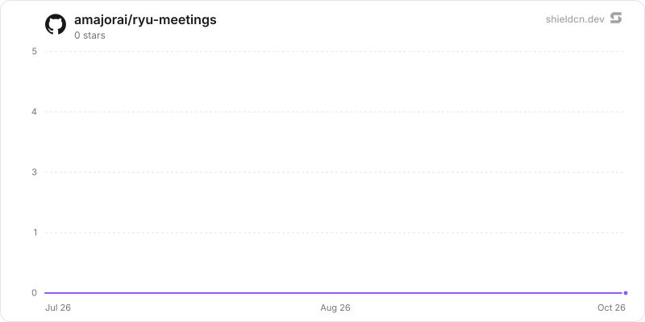

<div align="center">

# meetings

</div>

Record a call, transcribe it live, and generate structured AI notes with optional local speaker labeling.

> **The public home of `ryu-meetings`.** Source, builds, and releases live here —
> binaries for every platform are attached to each release.
>
> This tree is generated from the Ryu monorepo, so commits pushed here
> directly are replaced on the next sync. **Pull requests are welcome** —
> open them here and they are ported into the monorepo, then flow back out.
> Ryu as a whole: https://github.com/amajorai/ryu

## Install

**App:** [Install](ryu://apps/com.ryu.meetings) (opens the Ryu desktop app and asks you to confirm)

**CLI:**

```bash
ryu apps add com.ryu.meetings
```

**From source:**

```bash
cargo build --release --manifest-path backend/Cargo.toml
```

Prebuilt binaries for every platform are attached to [each release](https://github.com/amajorai/ryu/releases).

## License

Apache-2.0 — see [LICENSE](./LICENSE).

## Parts

- **`backend/` (`ryu-meetings`)** — an extracted Core capability crate and the **brain**:
  the meeting session lifecycle, the chunked-transcription pipeline (reusing the existing
  whisper/parakeet voice path), transcript accumulation + the shared `ryu-diarization`
  primitive, AI note generation,
  persistence (SQLite `MeetingStore`), templates, and the live SSE stream. **Now served
  OUT-OF-PROCESS** by the standalone `[[bin]] ryu-meetings` (`kind:local`, `public_mount
  /api/meetings`, port 7998) via the generic ext-proxy loader; Core links **zero meeting code** (no
  path-dep, no in-process mount). Its host needs (preferences, the STT transcribe path, the Gateway
  note-gen + auto-title calls, and the Spaces note store) are inverted through the `MeetingsHost`
  trait, so the crate has **zero dependency on `apps/core`**. **Sidecar-ization status (2026-07-18):
  OUT-OF-PROCESS.** The kernel weld (`ryu_hardware::HardwareSession` holding a concrete
  `MeetingEngine` on the ambient-audio path) was **inverted** behind a minimal **`MeetingIngest`
  trait** (`crates/ryu-hardware/src/ingest.rs`: resume-check / open ambient meeting / append one WAV
  segment); `MeetingsClient` **is** the out-of-process impl. The append hop is **segment-rate, not
  frame-rate** — `on_audio` accumulates each ~20 ms Opus frame and flushes once per ~1 s of buffered
  PCM (`AMBIENT_FLUSH_SAMPLES`), so it is ~**1 POST/s/device** carrying a ~1 s WAV, never the
  audio-hot-path kernel case. The `save_notes_to_space` weld became the Core kernel capability `POST
  /api/host/capability/spaces.fileNotes` (gated on the declared `spaces:docs` grant).
- **Audio capture is a device-bound sensor, not in this crate.** Because Core can run on a
  remote node, mic + system-loopback capture and mic-in-use detection live in **Shadow**,
  which streams raw WAV chunks up to `POST /api/meetings/:id/chunk` and posts detections to
  `POST /api/meetings/detect`. Core only ingests, transcribes, and debounces.
- **`ui/` (`@ryu/meetings-app`)** — the companion surface: a React app built to one
  self-contained HTML via `vite-plugin-singlefile`, consuming `@ryu/ui`. Full-page
  Companion (Path B, `ui_format: "html"`).

## Manifest

- **id** `@ryu/meetings` · companion `Meetings` (icon `mic-01`).
- **requires** `@ryu/spaces` (>=1.0.0) with grant `spaces:docs` — the dependency graph
  refuses to disable Spaces out from under it.
- **grants** `spaces:docs` (write notes into the Meetings Space) + `meetings:crud`.

## Surface

`/api/meetings` (list/create) · per-meeting `:id`, `title`, `chunk`, `finalize`,
`transcript` · `detect` · `templates` · `import` (audio-file) · `stream` (SSE).

## Swap seam

The notes model is never hardcoded (`default_notes_model` → prefs → Gateway-routed); STT
reuses the swappable voice path. Speaker-turn inference uses the model-neutral
`ryu-diarization` request/response contract with local pyannote and Nemotron adapters;
Meetings owns transcript mapping and the stereo microphone override. Notes calls stay
Gateway-governed, while diarization remains local.

## At rest

`meetings.db` seals each meeting's JSON (title, participants, app, generated notes) and
`segments.text` / `segments.speaker` per value (`encb:v1:`, store `meetings.db`; a meeting
binds its id, a segment its meeting id and row id) under the `@ryu/meetings` plugin subkey
Core delivers to the `ryu-meetings` sidecar (`crypto:seal` in that sidecar's
`host_api.grants`; the Python `ryu-diarize` sidecar gets no key, receives audio only over
loopback and keeps it in memory: the upload is never spooled to a temp file and the adapters
decode it in memory, so the decrypted recording is never written to disk). Ids, offsets and timestamps stay plaintext. The diarization audio
(`audio/<meeting>.pcm`) is one `RYU-SL01` sealed log per meeting (store `meetings-audio`,
AAD bound to the meeting id): each ingested chunk appends one record under a random nonce
through a writer kept open per meeting (an append never re-reads the log), a torn tail from
a crash is truncated when the log is reopened, and the committed record count is stored in
`meetings.pcm_records` so a log cut at a record boundary is refused instead of misaligning
speakers. Diarization reads the log back whole (`audio::read_pcm`).

Migration: legacy rows are sealed on open (`ryu_crypto::content_sqlite`, resumable and
idempotent; on a background connection above 20,000 segments), then freed pages are
scrubbed (`secure_delete = ON` on every connection). Legacy plaintext PCM files still read;
the sidecar rewrites each as a sealed log in the background (read back and compared before
it replaces the original) and records its count; an append to a legacy file converts it
first. Key states (`backend/src/seal_keys.rs`):

- **Compat mode**: under an older Core that delivers no key, a never-sealed store keeps
  working in plaintext (PCM included) and `/health` reports `sealing.state = "compat"`
  ("waiting for a Ryu update"); a store that holds sealed data refuses writes instead.
- **Key mismatch**: a store sealed under another key reports `sealing.state = "unhealthy"`
  and refuses writes; it is never resealed or reset.
- **Standalone** (no `RYU_PLUGIN_DATA_DIR`): `RYU_MASTER_KEY` if set, else a generated root
  in `<plugin data dir>/secrets/standalone-root.key` (0600) whose key check value is pinned.

The standalone satellite mirror builds `ryu-crypto` from crates.io at the declared version,
so the release train that ships this must publish `ryu-crypto` first (already ordered before
app backends in `tools/publish-crates.sh`).

## Star History

<a href="https://github.com/amajorai/ryu-meetings/stargazers">
  <picture>
    <source media="(prefers-color-scheme: dark)" srcset="./.github/shieldcn/star-chart-dark.svg" />
    
  </picture>
</a>
